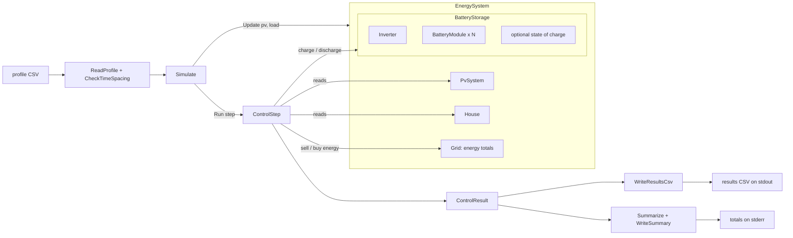

# home-ems-cpp

[](https://github.com/a-eldesouky/home-ems-cpp/actions/workflows/ci.yml)

A C++17 library and command-line tool that decides, step by step, how a home
with rooftop PV and a battery should split its power between the battery and
the public grid.

## Problem and approach

At any moment a home either produces more power than it uses (a surplus) or
less (a shortage). A battery can absorb a surplus or cover a shortage, but
only as fast as its inverter and its battery modules allow, and only while it
has room or charge left. Whatever the battery cannot take must go to the
grid, and whatever it cannot supply must come from the grid.

For each time step the controller computes `net = pv - load` and
`limit = min(inverter rating, sum of module ratings)`. On a surplus it charges
the battery with `min(net, limit)` and sells the rest. On a shortage
(including `net == 0`) it discharges the battery with `min(-net, limit)` and
buys the rest. With the optional state of charge model, the limit also
shrinks to the room left below the maximum charge level (when charging) or the
energy left above the minimum (when discharging) for that step. The grid
keeps energy totals in Wh, computed from the step length.

The tool reads a PV and load profile from CSV, runs this rule once per row,
writes one CSV row of results per step to stdout and prints energy totals to
stderr.

The components (PV system, house, grid, inverter, battery modules) are small
value types with strong unit types (`Power`, `Energy`, `Hours`, `Voltage`,
...), so a voltage cannot be passed where a power is expected, and power
becomes energy only by multiplying with a duration. `EnergySystem` owns all
components by value, with no raw pointers or shared ownership. Constructors
and setters reject NaN, infinite and out-of-range values, and a call that
throws leaves the object unchanged. The formulas are in
[docs/design.md](docs/design.md).

## Architecture



| Path | Contents |
|---|---|
| `include/home_ems/` | Public headers |
| `src/` | Library sources |
| `apps/` | `home-ems` command-line tool |
| `examples/` | `single_step`, a minimal use of the library API |
| `tests/` | GoogleTest unit tests and CLI checks |
| `data/` | Synthetic sample profile |
| `scripts/` | Generator for the synthetic profile |
| `docs/` | Design notes |

## Build and run

Needs CMake 3.20 or newer and a C++17 compiler (tested with GCC 13.3 and
Clang 14.0). GoogleTest 1.15.2 is downloaded by CMake when tests are enabled.

```bash
cmake -S . -B build -DCMAKE_BUILD_TYPE=Release
cmake --build build
ctest --test-dir build --output-on-failure
```

```bash
./build/home-ems data/sample_day.csv
./build/home-ems --capacity-wh 2500 --efficiency 0.95 data/sample_day.csv
./build/home-ems --inverter-max-w 2500 data/sample_day.csv > results.csv
./build/single_step
```

Command-line options:

| Option | Default | Meaning |
|---|---|---|
| `--inverter-max-w W` | 4000 | Inverter power limit |
| `--step-minutes M` | 60 | Length of one row, 1 to 1440 |
| `--capacity-wh WH` | off | Usable capacity of one module; turns on the state of charge model |
| `--soc-min PCT` | 10 | Lowest state of charge |
| `--soc-max PCT` | 95 | Highest state of charge |
| `--soc-initial PCT` | 50 | State of charge before the first row |
| `--efficiency E` | 1 | One-way efficiency for charging and for discharging, in (0, 1] |

The `--soc-*` and `--efficiency` options need `--capacity-wh`. The tool
always builds the default system: three 2000 W battery modules.

CMake options:

| Option | Default | Effect |
|---|---|---|
| `HOME_EMS_BUILD_TESTS` | `ON` when top level | Unit tests and CLI checks |
| `HOME_EMS_BUILD_EXAMPLES` | `ON` when top level | `single_step` example |
| `HOME_EMS_WARNINGS_AS_ERRORS` | `ON` | `-Werror` on this project's targets |
| `HOME_EMS_ENABLE_ASAN` | `OFF` | AddressSanitizer |
| `HOME_EMS_ENABLE_UBSAN` | `OFF` | UndefinedBehaviorSanitizer |
| `HOME_EMS_ENABLE_COVERAGE` | `OFF` | `--coverage` instrumentation |

Warnings enabled on this project's targets: `-Wall -Wextra -Wpedantic
-Wshadow -Wconversion -Wsign-conversion -Wold-style-cast -Wnon-virtual-dtor
-Woverloaded-virtual -Wnull-dereference`. `compile_commands.json` is written
to the build directory.

Install the library, headers and CMake package, then use it from another
project with `find_package(home_ems)` and `home_ems::home_ems`:

```bash
cmake --install build --prefix ~/.local
```

Sanitizer and coverage builds are for testing only; install a plain build.

## Example

`data/sample_day.csv` is synthetic. It was generated by
`scripts/generate_profile.py` (seeded, so the same seed gives the same file)
and does not come from any real installation:

```bash
python3 scripts/generate_profile.py data/sample_day.csv
```

Input, selected rows:

```text
time,pv_w,load_w
06:00,0,438
07:00,306,1590
08:00,1154,1595
10:00,3904,338
11:00,4866,354
12:00,6146,353
18:00,1172,1163
19:00,302,4594
20:00,0,4372
```

### Without a state of charge model

Output of `./build/home-ems data/sample_day.csv` for the same rows, then the
totals for all 24 rows. The limit is 4000 W (the inverter; the three modules
allow 6000 W). `battery_w` is positive when charging and negative when
discharging:

```text
time,pv_w,load_w,net_w,battery_w,grid_export_w,grid_import_w,soc_pct,error
06:00,0.0,438.0,-438.0,-438.0,0.0,0.0,,
07:00,306.0,1590.0,-1284.0,-1284.0,0.0,0.0,,
08:00,1154.0,1595.0,-441.0,-441.0,0.0,0.0,,
10:00,3904.0,338.0,3566.0,3566.0,0.0,0.0,,
11:00,4866.0,354.0,4512.0,4000.0,512.0,0.0,,
12:00,6146.0,353.0,5793.0,4000.0,1793.0,0.0,,
18:00,1172.0,1163.0,9.0,9.0,0.0,0.0,,
19:00,302.0,4594.0,-4292.0,-4000.0,0.0,292.0,,
20:00,0.0,4372.0,-4372.0,-4000.0,0.0,372.0,,
```

```text
steps: 24 (failed: 0)
step length: 60.0 min
grid export: 5836.0 Wh
grid import: 664.0 Wh
battery charge: 30811.0 Wh
battery discharge: 14053.0 Wh
```

Without a capacity the battery takes in 30811 Wh over the day, far more than
three modules could hold. The run below adds a capacity.

### With a state of charge model

Output of
`./build/home-ems --capacity-wh 2500 --efficiency 0.95 data/sample_day.csv`
for the same rows. Capacity is 3 × 2500 = 7500 Wh, starting at 50% and kept
between 10% and 95%:

```text
time,pv_w,load_w,net_w,battery_w,grid_export_w,grid_import_w,soc_pct,error
06:00,0.0,438.0,-438.0,-438.0,0.0,0.0,14.8,
07:00,306.0,1590.0,-1284.0,-343.0,0.0,941.0,10.0,
08:00,1154.0,1595.0,-441.0,0.0,0.0,441.0,10.0,
10:00,3904.0,338.0,3566.0,3566.0,0.0,0.0,78.5,
11:00,4866.0,354.0,4512.0,1302.5,3209.5,0.0,95.0,
12:00,6146.0,353.0,5793.0,0.0,5793.0,0.0,95.0,
18:00,1172.0,1163.0,9.0,0.0,9.0,0.0,95.0,
19:00,302.0,4594.0,-4292.0,-4000.0,0.0,292.0,38.9,
20:00,0.0,4372.0,-4372.0,-2056.2,0.0,2315.8,10.0,
```

```text
steps: 24 (failed: 0)
step length: 60.0 min
grid export: 29936.5 Wh
grid import: 5810.8 Wh
battery charge: 6710.5 Wh
battery discharge: 8906.2 Wh
final state of charge: 10.0 %
```

At 07:00 the battery reaches 10% part-way through the hour, so only 343 W
comes from it and 941 W is bought. At 11:00 it fills up to 95% and the rest of
the surplus is sold. From 12:00 to 18:00 it is full and every surplus goes to
the grid.

### Invalid input

A bad value or a time gap stops the run with a message and a non-zero exit
code:

```text
$ ./build/home-ems tests/data/bad_value.csv
error: line 3: pv_w is not a number: 'abc'
$ ./build/home-ems --step-minutes 30 data/sample_day.csv
error: line 3: time '01:00' is not 30 minutes after '00:00'
```

## Tests and coverage

`ctest` runs 166 tests: 154 GoogleTest cases in 23 suites, plus 12 checks
that run the `home-ems` tool and the example (sample run, totals, state of
charge run, `--help`, missing file, invalid option, no arguments, header-only
file, invalid value, step length mismatch, `--soc-*` without
`--capacity-wh`, and the example program).

All 166 pass with GCC 13.3.0 and Clang 14.0.6, in Debug and Release, with
AddressSanitizer and UndefinedBehaviorSanitizer on, and with zero compiler
warnings.

Coverage (GCC 13.3, gcovr 7.2, `src/`, `apps/` and `include/`):

| Metric | Covered | Total | Percent |
|---|---|---|---|
| Lines | 632 | 635 | 99.5% |
| Functions | 141 | 141 | 100.0% |
| Branches | 627 | 898 | 69.8% |

Two of the three uncovered lines are closing braces after a `return` that
gcov counts as lines. The third is the zero-voltage check in
`Inverter::BatteryCurrent`, which cannot be reached through the public API
because `BatteryModule` already rejects a voltage of zero or below. The
branch count includes the exception paths that GCC generates for every call
that can throw.

To reproduce:

```bash
cmake -S . -B build/coverage -DCMAKE_BUILD_TYPE=Debug -DHOME_EMS_ENABLE_COVERAGE=ON
cmake --build build/coverage
ctest --test-dir build/coverage
gcovr --root . --filter src/ --filter apps/ --filter include/ --print-summary build/coverage
```

## Style and static analysis

Formatting follows the Google C++ Style Guide (`.clang-format`). `.clang-tidy`
enables the `bugprone-*`, `cppcoreguidelines-*`, `google-*` and
`performance-*` groups plus Google naming checks, with warnings as errors.
clang-tidy 18.1.8 and 21.1.6 report no findings on the 26 source files in
`src/`, `apps/`, `examples/` and `tests/`. Two suppressions remain, each with
its reason in the code: pointer arithmetic on `argv` in `apps/main.cc`, and
the non-const `char*` that `strtod` needs in `src/parse_number.cc`.

CI (GitHub Actions, `ubuntu-latest`) builds and tests with GCC and Clang in
Debug (with ASan and UBSan) and Release, runs clang-tidy, checks formatting
and reports coverage.

## Known limits

- The state of charge model is a simple energy balance: no temperature
  effects, ageing, self-discharge, or power limits that change with the state
  of charge. One efficiency value applies at every power level.
- Every row has the same length, set with `--step-minutes`. The `time` column
  is checked against it when it uses `HH:MM`, but it is not used to compute
  the length.
- The command-line tool always uses three 2000 W modules; other setups need
  the library API.
- When a step fails inside the library (an inverter rating of zero or below,
  or an invalid step length), `ControlStep` does not throw. It returns the
  reason in `ControlResult::error`, reports a battery power of 0 and leaves
  the battery and grid unchanged.
  The CLI rejects such values before it starts.

## License

MIT. See [LICENSE](LICENSE).
